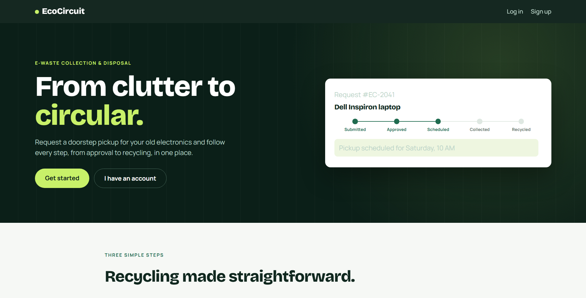
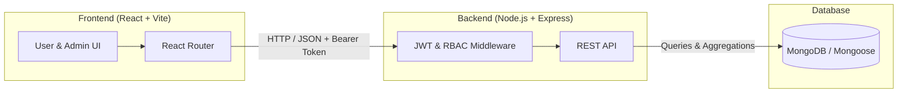
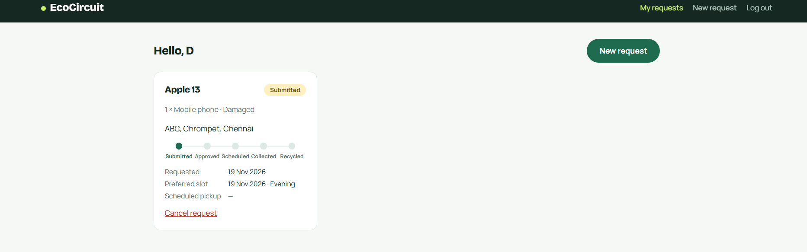
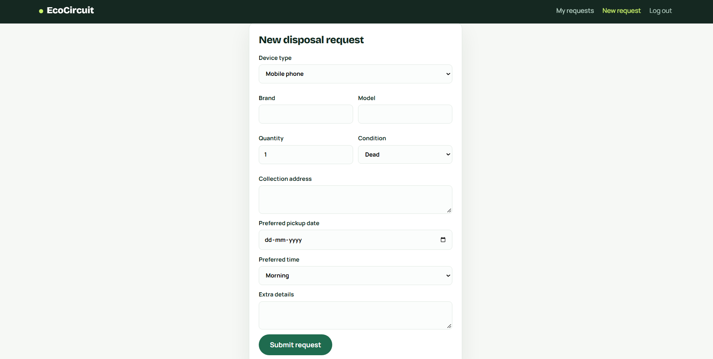
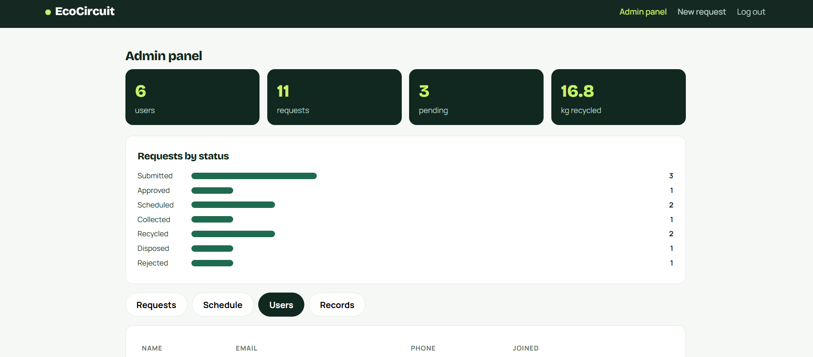

# EcoCircuit – E-Waste Collection and Disposal Management System

A full-stack MERN web application that lets users request e-waste pickups and track them, while admins review requests, schedule collections and maintain recycling records.



## Problem
E-waste is growing, and improper disposal harms the environment and public health. Collection is often manual, with scattered records and no way for users to track their requests.

## Solution
EcoCircuit provides one platform where users submit disposal requests and follow them from submission to recycling, and admins manage the whole process.

## Features

**User**
- Register and log in securely
- Submit e-waste requests (device type, brand, quantity, condition, address, preferred date and time)
- Track each request through Submitted → Approved → Scheduled → Collected → Recycled / Disposed
- Cancel requests that are still pending

**Admin**
- Dashboard with request statistics and a status chart
- Search and filter requests, approve or reject, add notes
- Schedule collections and view upcoming pickups
- Manage users
- Maintain recycling and disposal records, with CSV export

**General**
- JWT authentication with role-based access control
- Passwords hashed with bcrypt
- Responsive interface

## Tech Stack
| Layer | Technology |
|---|---|
| Frontend | React, React Router, Vite |
| Backend | Node.js, Express.js |
| Database | MongoDB, Mongoose |
| Auth | JSON Web Tokens, bcrypt |

## Architecture
React frontend → REST API (Express + Node) → MongoDB

## Architecture



## Screenshots
| User dashboard | New request |
|---|---|
|  |  |

| Admin panel | Recycling records |
|---|---|
|  |  |

## Getting Started

**Prerequisites:** Node.js 18+ and MongoDB (local or Atlas)

```bash
# 1. Clone
git clone https://github.com/YOUR-USERNAME/ecocircuit-ewaste-management.git
cd ecocircuit-ewaste-management

# 2. Backend
cd server
npm install
cp .env.example .env      # then edit the values
npm start                 # http://localhost:5000

# 3. Frontend (new terminal)
cd client
npm install
npm run dev               # http://localhost:5173
```

**Environment variables** (`server/.env`)
```
PORT=5000
MONGO_URI=mongodb://127.0.0.1:27017/ecocircuit
JWT_SECRET=your_secret
ADMIN_EMAIL=admin@ecocircuit.com
ADMIN_PASSWORD=your_admin_password
```
The admin account is created automatically on first run.

## API Overview
| Method | Route | Access |
|---|---|---|
| POST | /api/auth/register, /api/auth/login | Public |
| GET | /api/auth/me | Logged in |
| GET, POST | /api/requests | User (own) / Admin (all) |
| PATCH | /api/requests/:id | Admin |
| DELETE | /api/requests/:id | User (pending) / Admin |
| GET, DELETE | /api/admin/users | Admin |
| GET, POST | /api/admin/records | Admin |
| GET | /api/admin/stats | Admin |

## Project Structure
```
client/src/   pages, components, API helper
server/       models.js, routes.js, server.js
```

## Future Scope
- Email and SMS notifications on status changes
- Photo upload for devices
- Map-based pickup routes
- Real-time updates with WebSockets
- Cloud deployment
